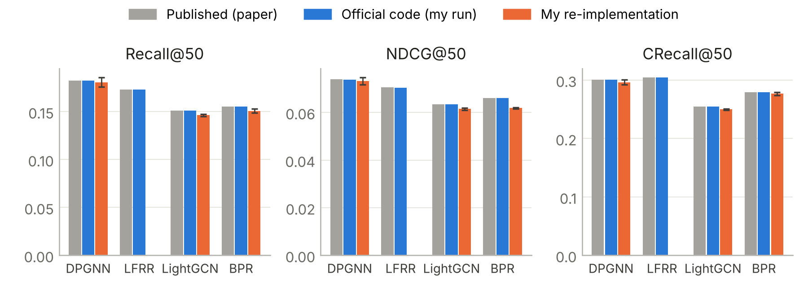

# DPGNN Replication - Reciprocal Recommendation on Libimseti

Replication of **DPGNN** (*Modeling Two-Way Selection Preference for Person-Job Fit*, Yang et al., RecSys 2022 — [RUCAIBox/DPGNN](https://github.com/RUCAIBox/DPGNN)) for reciprocal (two-sided) recommendation, done as part of a Deep Learning course project on matrimony matchmaking with graph neural networks.

The original DPGNN data (online recruitment) is not public. The same group re-ran DPGNN with the same code on the public **Libimseti** online-dating dataset in their benchmark **CRRS** (KDD 2024 — [RUCAIBox/CRRS](https://github.com/RUCAIBox/CRRS)), so this replication uses that setting.

## What is in this repository

1. **Official-code run** — the authors' CRRS / RecBole code, run unchanged on Libimseti (DPGNN, LFRR, LightGCN, BPR). Only compatibility shims for current library versions were added.
2. **My re-implementation** — DPGNN, LightGCN, BPR-MF and a popularity baseline written from scratch in plain PyTorch, using the same split and evaluation protocol, trained with 3 seeds (2020, 2021, 2022).
3. **Extra experiments** on my implementation — ablations and a two-way scoring analysis.

## Main results (Libimseti test set, top 50, full ranking)

| Model | Metric | Published | Official code (my run) | My re-implementation (3 seeds) |
|---|---|---|---|---|
| DPGNN | Recall@50 | 0.1825 | 0.1825 | 0.1808 ± 0.0049 |
| | NDCG@50 | 0.0739 | 0.0738 | 0.0732 ± 0.0015 |
| | CRecall@50 | 0.3007 | 0.3007 | 0.2965 ± 0.0041 |
| LFRR | Recall@50 | 0.1729 | 0.1729 | – |
| | NDCG@50 | 0.0706 | 0.0704 | – |
| | CRecall@50 | 0.3045 | 0.3045 | – |
| LightGCN | Recall@50 | 0.1510 | 0.1510 | 0.1463 ± 0.0013 |
| | NDCG@50 | 0.0634 | 0.0634 | 0.0615 ± 0.0005 |
| | CRecall@50 | 0.2549 | 0.2549 | 0.2498 ± 0.0013 |
| BPR | Recall@50 | 0.1552 | 0.1552 | 0.1508 ± 0.0022 |
| | NDCG@50 | 0.0661 | 0.0661 | 0.0619 ± 0.0003 |
| | CRecall@50 | 0.2795 | 0.2795 | 0.2767 ± 0.0025 |



- The official code reproduces all 12 published numbers (largest difference 0.0002).
- My re-implementation is within about 1–3% on most metrics (largest gap −6%, BPR NDCG) and preserves the model ranking.

### Ablations (my implementation, CRecall@50, mean ± std over 3 seeds)

| Variant | CRecall@50 |
|---|---|
| DPGNN (full) | 0.2965 ± 0.0041 |
| w/o contrastive loss | 0.3211 ± 0.0111 |
| w/o one-sided edges | 0.3222 ± 0.0025 |
| w/o both | 0.3027 ± 0.0011 |

## Repository layout

```
src/                    re-implementation modules (also written out by the notebook)
  rep_data.py           Libimseti loading, RecBole-style 80/10/10 split grouped by man
  rep_eval.py           Recall / Precision / NDCG / MRR, CRecall, SRecall, RNDCG
  rep_models.py         DPGNN, LightGCN, BPR-MF in plain PyTorch
  rep_train.py          training loop, early stopping on valid CRecall@50 (patience 30)
  rep_report.py         tables and figures
  run_official.py       runner for the official CRRS code + compatibility shims
notebooks/
  DPGNN_Replication_kaggle.ipynb    my re-implementation: 3 seeds, ablations, two-way analysis
  DPGNN_Official_Code_kaggle.ipynb  clones CRRS and runs the official code
results/
  table_final.csv                   the table above
  fig_final_comparison.png
  ours/                             my runs (JSON), tables, figures
  official/                         official-code metrics (JSON) and training logs
docs/                               results summary (PDF / Word)
```

## How to run (Kaggle)

1. Create a new Kaggle notebook and import one of the notebooks from `notebooks/` (File → Import Notebook).
2. Settings: **Accelerator: GPU T4 x2** (one GPU is used), **Internet: on**, **Persistence: Files only**.
3. **My re-implementation:** run all cells of `DPGNN_Replication_kaggle.ipynb`. The data is read from the cloned CRRS repository. A full run (3 seeds × 4 models + ablations) takes about 1.5–2 h on a T4; results are zipped to `/kaggle/working/dpgnn_results.zip`.
4. **Official code:** run `DPGNN_Official_Code_kaggle.ipynb`; cell 5 is a 1-epoch smoke test. Set `RUN_FULL = True` in the first cell (best via *Save Version → Save & Run All*) to train all four models (about 30 min). Results are zipped to `/kaggle/working/official_results.zip`.

## Evaluation protocol (same as CRRS)

- Random 80/10/10 split per man (RecBole `RS` + `RO`, seed 2020); targets are mutual matches (`label = 1`).
- One-sided likes (`label = 0`) are used only as extra graph edges for DPGNN.
- Full ranking on both sides (men rank women, women rank men); past positives are masked. For LightGCN the official code masks all training interactions (`REMAIN_NEG: True`); my evaluation does the same.
- Recall / NDCG are averaged over the two sides. CRecall@50 = a test match counts as found if either side's top 50 contains it.

## Compatibility fixes for the official code

The CRRS code targets 2022-era libraries. To run it on current Kaggle images (Python 3.13, NumPy 2, PyTorch 2.x, SciPy ≥ 1.13), `src/run_official.py` adds:

1. `recbole==1.1.1` (1.2.0 renamed `eval_neg_sample_args`);
2. NumPy aliases removed in NumPy 2 (`np.float`, `np.bool`, `np.long`, `np.str`, `np.float_`, …);
3. `pandas.DataFrame.append` (removed in pandas 2);
4. `torch.load(..., weights_only=False)` default (PyTorch 2.6);
5. `scipy.sparse.dok_matrix._update` (used by RecBole's LightGCN, removed in SciPy 1.13).

None of these change model, data or metric logic.

## Credits

- Yang et al., *Modeling Two-Way Selection Preference for Person-Job Fit*, RecSys 2022 — [RUCAIBox/DPGNN](https://github.com/RUCAIBox/DPGNN).
- CRRS benchmark and Libimseti preprocessing — [RUCAIBox/CRRS](https://github.com/RUCAIBox/CRRS) (KDD 2024).
- [RecBole](https://github.com/RUCAIBox/RecBole).

All original code and data belong to their authors; this repository only contains my own code, runner scripts and results.
